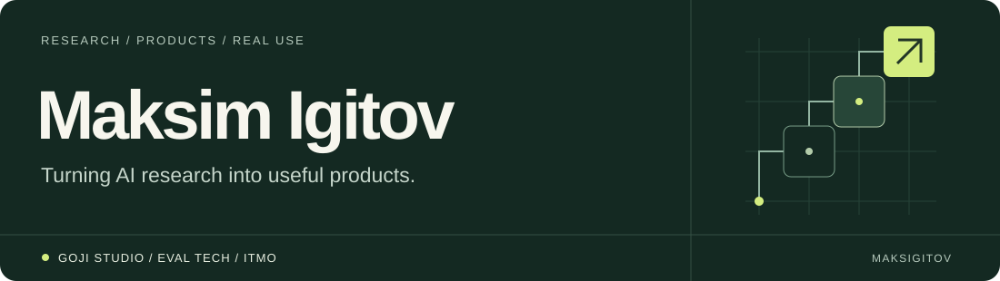
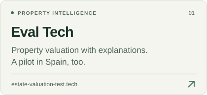
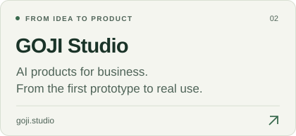
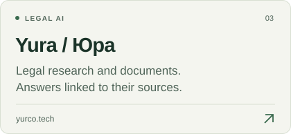
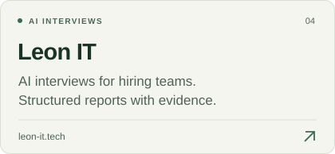
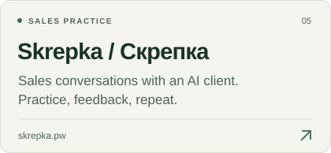
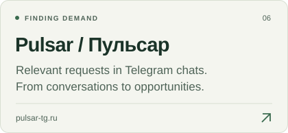

<picture>
  <source media="(max-width: 600px)" srcset="assets/hero-mobile-en.svg">
  
</picture>

<b>Open to opportunities</b> · Employment, ambitious projects and collaborations. 
<a href="README.ru.md">По-русски</a> · <a href="#selected-products">Products</a> · <a href="#experience">Experience</a> · <a href="#public-code">Public code</a>

  
  
  
  

I started **[GOJI Studio](https://goji.studio/)** and **[Eval Tech](https://estate-valuation-test.tech/)**. I connect applied AI, product development and explainable machine learning. Currently pursuing a **Master's in Artificial Intelligence at ITMO University**.

<table>
<tr>
<td width="33%" align="center"><h3>20+</h3>prize-winning finishes in hackathons &amp; case competitions</td>
<td width="33%" align="center"><h3>1st place</h3>Cup IT 2025 Data Analytics</td>
<td width="33%" align="center"><h3>ITMO · 2026</h3>Best Graduate Entrepreneurship</td>
</tr>
</table>

## Selected products

From the first prototype to a working product — a selection of what I've worked on.

<a href="https://estate-valuation-test.tech/"><picture><source media="(prefers-color-scheme: dark)" srcset="assets/eval-en-dark.svg"></picture></a>
<a href="https://goji.studio/"><picture><source media="(prefers-color-scheme: dark)" srcset="assets/goji-en-dark.svg"></picture></a>

<a href="https://yurco.tech/"><picture><source media="(prefers-color-scheme: dark)" srcset="assets/yura-en-dark.svg"></picture></a>
<a href="https://leon-it.tech/"><picture><source media="(prefers-color-scheme: dark)" srcset="assets/leon-en-dark.svg"></picture></a>

<a href="https://skrepka.pw/"><picture><source media="(prefers-color-scheme: dark)" srcset="assets/skrepka-en-dark.svg"></picture></a>
<a href="https://pulsar-tg.ru/"><picture><source media="(prefers-color-scheme: dark)" srcset="assets/pulsar-en-dark.svg"></picture></a>

## Experience

**Research ML · T-Bank** &nbsp; May 2025–present  
Successfully contributed to an automated Java project migration tool.

**Research ML · NIRMA, ITMO University**  
Interpretable machine-learning models for real-estate valuation: property characteristics, location and the urban environment.

## Research

**Why do homes cost what they do?** My bachelor's thesis explores how an apartment, its location and its urban environment contribute to the asking price.

<table>
<tr>
<td width="50%"><h3>17,043</h3>apartment listings in Saint Petersburg</td>
<td width="50%"><h3>71,188</h3>citizen reports about the urban environment</td>
</tr>
</table>

`LightGBM` · `SHAP` · `Geospatial features` · `Spatial validation`

**ITMO University** — MSc in Artificial Intelligence, 2026–2028 · Bachelor's in Business Informatics, 2022–2026.

## Public code

| Project | Focus |
| :--- | :--- |
| **[Agent Hub ↗](https://github.com/MaximIgitov/agent_hub)** | GitHub issue → pull request → CI → independent review. Python, FastAPI, GitHub Actions. |
| **[Cup IT 2025 ↗](https://github.com/MaximIgitov/cup_it_25)** | Our winning Data Analytics entry: medical payment analysis and forecasting with SARIMA and Prophet. |
| **[Hallucination Detection ↗](https://github.com/MaximIgitov/SlovarikDB_Hallucination_Detection)** | Our X5 Tech AI Hack team solution: DeBERTa and LLM-based fact checking. Team repository fork. |
| **[Cup IT 2024 ↗](https://github.com/MaximIgitov/cup_it_24)** | Our second-place solution for anomaly detection in time series. |

## Recognition & talks

| | |
| :--- | :--- |
| **Research** | Best Young Scientist Presentation, XIV ITMO Congress of Young Scientists · Best Poster, SBAS 2025. |
| **Scholarships** | T-Bank, 2024 · Selectel, 2025 · Alfa-Budushchee, 2025. |
| **Speaking** | Podlodka Java Crew, 2025. |

---

**Let's build something useful.**  
Tell me about your opportunity: **[@MaksIgitov](https://t.me/MaksIgitov)** · **[mdigitov@itmo.ru](mailto:mdigitov@itmo.ru)**
