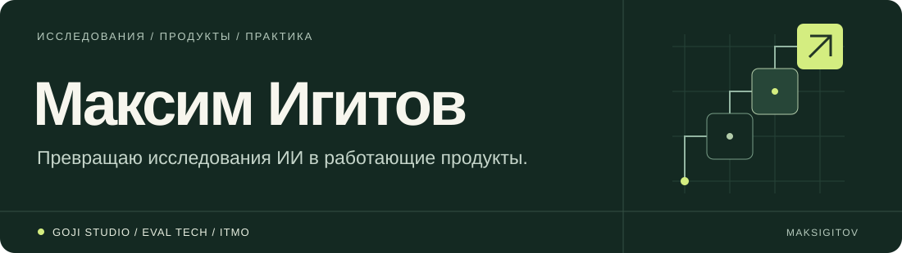
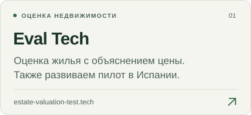
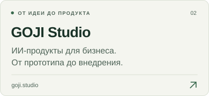
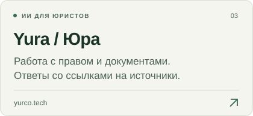
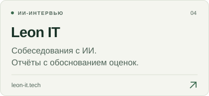
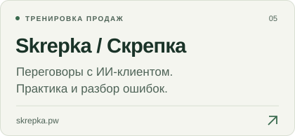
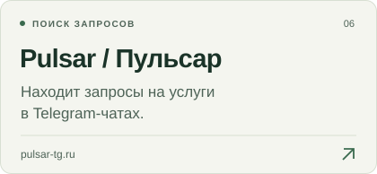

<picture>
  <source media="(max-width: 600px)" srcset="assets/hero-mobile-ru.svg">
  
</picture>

<b>Открыт к предложениям</b> · Работа, интересные проекты и сотрудничество. 
<a href="README.md">English</a> · <a href="#проекты">Проекты</a> · <a href="#опыт">Опыт</a> · <a href="#открытый-код">Открытый код</a>

  
  
  
  

Основал **[GOJI Studio](https://goji.studio/)** и **[Eval Tech](https://estate-valuation-test.tech/)**. Соединяю прикладной ИИ, создание продуктов и объяснимое машинное обучение. Учусь в **магистратуре ИТМО на программе «Искусственный интеллект»**.

<table>
<tr>
<td width="33%" align="center"><h3>20+</h3>призовых мест на хакатонах и кейс-чемпионатах</td>
<td width="33%" align="center"><h3>1-е место</h3>Cup IT 2025 Аналитика данных</td>
<td width="33%" align="center"><h3>ИТМО · 2026</h3>Лучший выпускник Предпринимательская деятельность</td>
</tr>
</table>

## Проекты

От первого прототипа до работающего продукта — несколько проектов, над которыми я работаю.

<a href="https://estate-valuation-test.tech/"><picture><source media="(prefers-color-scheme: dark)" srcset="assets/eval-ru-dark.svg"></picture></a>
<a href="https://goji.studio/"><picture><source media="(prefers-color-scheme: dark)" srcset="assets/goji-ru-dark.svg"></picture></a>

<a href="https://yurco.tech/"><picture><source media="(prefers-color-scheme: dark)" srcset="assets/yura-ru-dark.svg"></picture></a>
<a href="https://leon-it.tech/"><picture><source media="(prefers-color-scheme: dark)" srcset="assets/leon-ru-dark.svg"></picture></a>

<a href="https://skrepka.pw/"><picture><source media="(prefers-color-scheme: dark)" srcset="assets/skrepka-ru-dark.svg"></picture></a>
<a href="https://pulsar-tg.ru/"><picture><source media="(prefers-color-scheme: dark)" srcset="assets/pulsar-ru-dark.svg"></picture></a>

## Опыт

**Research ML · Т-Банк** &nbsp; май 2025 — настоящее время  
Успешно работал над инструментом автоматической миграции Java-проектов.

**Research ML · НИРМА, ИТМО**  
Объяснимые модели машинного обучения для оценки недвижимости: вклад характеристик квартиры, расположения и городской среды в цену.

## Исследования

**Из чего складывается цена жилья?** В бакалаврской ВКР исследовал, как на цену предложения влияют сама квартира, расположение и городская среда.

<table>
<tr>
<td width="50%"><h3>17 043</h3>объявления о квартирах в Санкт-Петербурге</td>
<td width="50%"><h3>71 188</h3>обращений горожан о городской среде</td>
</tr>
</table>

`LightGBM` · `SHAP` · `Геопространственные признаки` · `Пространственная валидация`

**ИТМО** — магистратура «Искусственный интеллект», 2026–2028 · бакалавриат «Бизнес-информатика», 2022–2026.

## Открытый код

| Проект | Задача |
| :--- | :--- |
| **[Agent Hub ↗](https://github.com/MaximIgitov/agent_hub)** | GitHub Issue → Pull Request → CI → независимое ревью. Python, FastAPI, GitHub Actions. |
| **[Cup IT 2025 ↗](https://github.com/MaximIgitov/cup_it_25)** | Наше решение, победившее в «Аналитике данных»: анализ медицинских платежей и прогнозирование с SARIMA и Prophet. |
| **[Hallucination Detection ↗](https://github.com/MaximIgitov/SlovarikDB_Hallucination_Detection)** | Командное решение X5 Tech AI Hack: DeBERTa и проверка фактов с помощью LLM. Форк командного репозитория. |
| **[Cup IT 2024 ↗](https://github.com/MaximIgitov/cup_it_24)** | Наше решение для поиска аномалий во временных рядах — 2-е место. |

## Награды и выступления

| | |
| :--- | :--- |
| **Наука** | Лучший доклад молодого учёного, XIV Конгресс молодых учёных ИТМО · Лучший постер, SBAS 2025. |
| **Стипендии** | Т-Банк, 2024 · Selectel, 2025 · «Альфа-Будущее», 2025. |
| **Выступления** | Podlodka Java Crew, 2025. |

---

**Давайте сделаем что-то полезное.**  
Расскажите о задаче: **[@MaksIgitov](https://t.me/MaksIgitov)** · **[mdigitov@itmo.ru](mailto:mdigitov@itmo.ru)**
